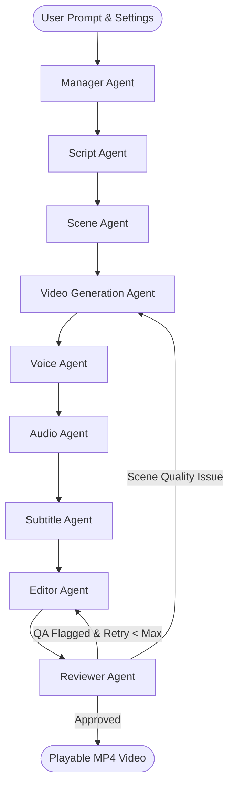

# AI Content Studio — Multi-Agent AI Video & Audio Generator

[](https://fastapi.tiangolo.com)
[](https://github.com/langchain-ai/langgraph)
[](https://react.dev)
[](https://tailwindcss.com)
[](https://ffmpeg.org)
[](https://github.com/rany2/edge-tts)

An autonomous multi-agent video and audio generation studio that converts natural language prompts into complete, social-media-ready videos with scenes, neural voice-over, acoustic background music, dynamic burned subtitles, and FFmpeg video assembly.

---

## 🏗️ Architecture & Multi-Agent Workflow

The system is orchestrated using **LangGraph** StateGraph with 9 specialized autonomous agents, conditional routing, and automatic validation retries:



---

## 🤖 Specialized Agent Responsibilities

| Agent | Responsibility | Output |
| :--- | :--- | :--- |
| **Manager Agent** | Analyzes user prompt, resolves aspect ratio, duration, theme, and language. | Structured Production Plan |
| **Script Agent** | Writes hook, scene narrations, on-screen text, and call to action. | JSON Multi-Scene Script |
| **Scene Agent** | Directs camera motion, lighting, visual styling, and scene pacing. | Enriched Video Prompts |
| **Video Generation Agent** | Converts scene prompts into high-aesthetic video clips (HF API / Procedural Engine). | Individual MP4 Scene Clips |
| **Voice Agent** | Generates multilingual neural TTS voice-over with exact speech boundaries. | `voice.mp3` |
| **Audio Agent** | Synthesizes harmonic ambient background music matching requested vibe. | `music.mp3` |
| **Subtitle Agent** | Computes timestamped SRT subtitles synchronized with narration. | `captions.srt` |
| **Editor Agent** | FFmpeg video stitcher, audio ducker (-18% music under speech), subtitle burner. | `final_video.mp4` |
| **Reviewer Agent** | OpenCV/ffprobe stream inspection, codec verification, duration checks, retry routing. | QA Review Report |

---

## 🌟 Key Features

1. **Autonomous Multi-Agent Pipeline**: Real LangGraph workflow that coordinates 9 distinct agents from planning to final export.
2. **100% Free / Free-Tier Priority**: Zero mandatory paid subscriptions. Supports Microsoft Edge Neural TTS (100+ languages, crystal clear), Google Gemini free tier, Groq ultra-fast Llama 3.3, and local procedural visual motion synthesis.
3. **Single-Scene Regeneration**: Regenerate only Scene 3 while keeping all other scenes intact; the Editor Agent automatically recompiles the final video.
4. **Real-time Live Monitoring**: Live WebSocket stream emitting agent progress, active node indicators, and continuous terminal logs.
5. **Multi-Format Aspect Ratios**:
   - `9:16` — Vertical Video (Instagram Reels, TikTok, YouTube Shorts)
   - `16:9` — Landscape High-Definition (YouTube, Websites)
   - `1:1` — Square (Feed Posts)
6. **Multi-Language Voice-over**: English, Urdu, Roman Urdu, Hindi, Spanish, French, and more.

---

## 🛠️ Tech Stack

### Backend
- **Framework**: Python 3.12, FastAPI, Pydantic V2, SQLAlchemy, SQLite
- **Multi-Agent Orchestration**: LangGraph, LangChain Core
- **Media & Synthesis**: FFmpeg, OpenCV, Pillow, Edge-TTS, NumPy, Wave
- **LLM APIs**: Google Generative AI (Gemini), Groq, OpenAI, Intelligent NLP Fallback

### Frontend
- **Framework**: React 18, Vite
- **Styling**: Tailwind CSS, Glassmorphism design system
- **Icons & UI**: Lucide React
- **Real-Time**: WebSockets & Server-Sent Events

---

## 🚀 Quick Start Guide

### 1. Prerequisites
- Python 3.10+
- Node.js 18+ and npm
- FFmpeg installed and added to system PATH (`ffmpeg -version`)

### 2. Backend Setup

```bash
# Clone or navigate to repository
cd "AI Content Studio"

# Create Python virtual environment
python -m venv venv
.\venv\Scripts\activate  # On Windows (or source venv/bin/activate on Linux/Mac)

# Install backend dependencies
pip install -r backend/requirements.txt

# Configure environment variables (optional free keys)
copy .env.example .env

# Run FastAPI backend server
python -m uvicorn backend.app.main:app --host 0.0.0.0 --port 8000 --reload
```

Backend will be available at: `http://localhost:8000`  
API Swagger Docs: `http://localhost:8000/docs`

---

### 3. Frontend Setup

```bash
# In a new terminal
cd frontend

# Install npm packages
npm install

# Start development server
npm run dev
```

Frontend will be available at: `http://localhost:5173`

---

## 🔑 Environment Configuration (`.env`)

```ini
# LLM Providers (Generous Free Tiers Available)
# Google AI Studio (Free: https://aistudio.google.com/)
GEMINI_API_KEY=
# Groq (Free: https://console.groq.com/)
GROQ_API_KEY=
OPENAI_API_KEY=

# Text-to-Video
HUGGINGFACE_API_KEY=

# Voice / TTS
DEFAULT_VOICE_PROVIDER=edge_tts
ELEVENLABS_API_KEY=

# App Settings
DATABASE_URL=sqlite:///./content_studio.db
OUTPUT_DIR=generated
MAX_RETRIES=2
```

---

## 🧪 Testing

Run backend unit and integration test suites:

```bash
.\venv\Scripts\python -m pytest backend/tests/test_agents.py backend/tests/test_api.py -v
```

Run complete end-to-end multi-agent pipeline test:

```bash
.\venv\Scripts\python -m pytest backend/tests/test_e2e.py -v
```

---

## 💡 Example Prompts to Try

1. *"Create a 30-second Instagram Reel explaining what AI agents are in simple language. Make it modern, energetic and suitable for social media. Use English narration, background music and subtitles."*
2. *"Create a 60-second educational video explaining Retrieval-Augmented Generation (RAG) with technological background music."*
3. *"Create a professional advertisement for an AI automation company targeting modern tech startups."*
4. *"Create a motivational short video about mastering AI skills in 2026."*

---

## 📂 Project Structure

```
AI Content Studio/
├── backend/
│   ├── app/
│   │   ├── agents/             # 9 Specialized AI Agents
│   │   │   ├── manager_agent.py
│   │   │   ├── script_agent.py
│   │   │   ├── scene_agent.py
│   │   │   ├── video_agent.py
│   │   │   ├── voice_agent.py
│   │   │   ├── audio_agent.py
│   │   │   ├── subtitle_agent.py
│   │   │   ├── editor_agent.py
│   │   │   └── reviewer_agent.py
│   │   ├── graph/              # LangGraph Orchestration & State
│   │   │   ├── state.py
│   │   │   └── workflow.py
│   │   ├── tools/              # LLM, Video, Voice, Audio & Media Tools
│   │   │   ├── llm/
│   │   │   ├── video/
│   │   │   ├── voice/
│   │   │   ├── audio/
│   │   │   ├── subtitles/
│   │   │   └── media/
│   │   ├── models/             # Database Models & Schemas
│   │   ├── services/           # Generation & Storage Isolation
│   │   ├── api/                # FastAPI Endpoints & WebSockets
│   │   └── main.py
│   ├── tests/                  # Unit & End-to-End Test Suite
│   └── requirements.txt
├── frontend/
│   ├── src/
│   │   ├── components/         # Dashboard, Studio, Progress, Result, Settings
│   │   ├── services/           # Axios & WebSocket Client
│   │   ├── App.jsx
│   │   ├── index.css           # Glassmorphism Design System
│   │   └── main.jsx
│   ├── package.json
│   └── vite.config.js
├── .env.example
├── README.md
└── run_generation.py
```

---

## 📜 License
MIT License. Built for Autonomous AI Content Creators.
