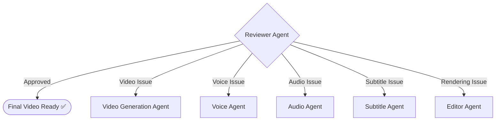

# 🎬 AI Content Studio

### Autonomous Multi-Agent AI Video Generator

[](https://fastapi.tiangolo.com)
[](https://github.com/langchain-ai/langgraph)
[](https://react.dev)
[](https://tailwindcss.com)
[](https://ffmpeg.org)
[](https://github.com/rany2/edge-tts)
[](https://magichour.ai)
[](https://python.org)

---

## 📖 What is AI Content Studio?

**AI Content Studio** is an AI-powered application that takes a simple text prompt (like *"Create a 30-second Instagram Reel about AI agents"*) and automatically generates a complete, ready-to-publish video. The video includes:

- 🎥 **AI-generated video clips** for each scene
- 🗣️ **Human-like voice-over narration** (Neural Text-to-Speech)
- 🎵 **Background music** (procedurally generated to match the mood)
- 📝 **Burned-in subtitles** (synchronized with the narration)
- ✂️ **Professional editing** (all clips stitched, audio balanced, exported as MP4)

The entire process is **fully automated** — you just type your idea, click Generate, and wait for the final video.

---

## 🧠 How Does It Work? (The Big Picture)

The system uses a **multi-agent pipeline** — a chain of 9 specialized AI "workers" (called **agents**), each responsible for one step of the video creation process. These agents communicate through a shared state and execute one after another, like an assembly line in a factory.

The pipeline is built using **LangGraph** (by LangChain), which is a framework for building stateful, multi-step AI workflows as directed graphs.

### The Pipeline Flow

```
User types a prompt
        ↓
  ┌─────────────┐
  │ Manager Agent │  ← Plans the entire video (duration, scenes, style)
  └──────┬──────┘
         ↓
  ┌─────────────┐
  │ Script Agent  │  ← Writes the narration, scene descriptions, on-screen text
  └──────┬──────┘
         ↓
  ┌─────────────┐
  │ Scene Agent   │  ← Enriches visual prompts with camera angles, lighting, style keywords
  └──────┬──────┘
         ↓
  ┌──────────────────────┐
  │ Video Generation Agent│ ← Generates actual video clips for each scene (MagicHour AI / Procedural)
  └──────┬───────────────┘
         ↓
  ┌─────────────┐
  │ Voice Agent   │  ← Generates voice-over narration audio (Edge TTS)
  └──────┬──────┘
         ↓
  ┌─────────────┐
  │ Audio Agent   │  ← Creates background music track
  └──────┬──────┘
         ↓
  ┌────────────────┐
  │ Subtitle Agent  │  ← Generates SRT subtitle file synchronized with narration
  └──────┬─────────┘
         ↓
  ┌─────────────┐
  │ Editor Agent  │  ← Stitches clips, mixes audio (voice + music with ducking), burns subtitles
  └──────┬──────┘
         ↓
  ┌────────────────┐
  │ Reviewer Agent  │  ← Quality checks: validates streams, duration, codec, resolution
  └──────┬─────────┘
         ↓
   ✅ Final MP4 Video Ready!
```

If the **Reviewer Agent** finds a problem (e.g., missing audio, wrong duration), it can **loop back** to the appropriate agent and retry automatically (up to 2 retries).

---

## 🤖 Detailed Agent Descriptions

### 1. Manager Agent (`manager_agent.py`)

**Job:** Analyze the user's prompt and create a structured production plan.

**How it works:**
- Takes the user's text prompt along with their settings (duration, aspect ratio, language, visual style, music mood).
- Sends everything to the LLM (Groq or Gemini) and asks it to create a JSON production plan.
- The plan includes: `title`, `theme`, `number_of_scenes`, `visual_style`, `music_preference`, etc.
- If the LLM fails after 2 attempts, uses a topic-aware fallback plan.

**Output:** A `production_plan` dictionary that guides all subsequent agents.

---

### 2. Script Agent (`script_agent.py`)

**Job:** Write the complete video script — narration text, visual descriptions, and on-screen text for every scene.

**How it works:**
- Takes the production plan and sends a detailed prompt to the LLM.
- Asks the LLM to generate a JSON script with fields: `title`, `hook`, `call_to_action`, and an array of `scenes`.
- Each scene has: `scene_number`, `duration`, `narration` (what the voice says), `visual_prompt` (what the viewer sees), `screen_text` (short text overlay), and `transition`.
- Validates the output (checks that every scene has narration and visual_prompt).
- Retries up to 3 times if the LLM output is malformed. If all attempts fail, uses a simplified prompt as a last resort.

**Output:** A `script` dictionary and a `scenes` array.

---

### 3. Scene Agent (`scene_agent.py`)

**Job:** Optimize each scene's visual prompt for high-quality video generation.

**How it works:**
- Takes each scene from the Script Agent and enriches the `visual_prompt` with professional cinematography keywords.
- Adds camera movement instructions (e.g., "slow cinematic push-in", "smooth orbital tracking", "dynamic ascending pan") — cycling through 5 different camera styles.
- Appends quality boosters: "ultra-detailed, volumetric atmospheric lighting, 8k render, masterpiece".
- Creates an enriched `video_prompt` field that replaces the original visual prompt.

**Output:** Updated `scenes` array with enriched `video_prompt`, `camera`, and `style` fields.

---

### 4. Video Generation Agent (`video_agent.py`)

**Job:** Convert each scene's text prompt into an actual video clip (MP4 file).

**How it works:**
- Loops through each scene and calls the configured video provider (MagicHour AI by default).
- **Smart caching:** Before generating, checks if a video file already exists on disk for that scene. If it does (and is bigger than 10KB), reuses it — saving API credits and time.
- **Single-scene regeneration:** Can regenerate only one specific scene while keeping others intact.
- **Fallback system:** If the primary provider (MagicHour) fails, automatically falls back to the Procedural Motion provider (which generates videos locally without any API).

**Video Providers Available:**

| Provider | Type | API Key Required? | Quality |
|----------|------|-------------------|---------|
| **MagicHour AI** | Cloud AI | Yes (`MAGIC_HOUR_API_KEY`) | High (real AI-generated video) |
| **Procedural Motion** | Local generation | No | Medium (animated gradient/motion graphics) |
| **Fal.ai** | Cloud AI | Yes (`FAL_KEY`) | High |
| **HuggingFace** | Cloud AI | Yes (`HUGGINGFACE_API_KEY`) | Medium |
| **Replicate** | Cloud AI | Yes (`REPLICATE_API_TOKEN`) | High |

**Output:** A list of file paths (`generated_videos`) — one MP4 per scene.

---

### 5. Voice Agent (`voice_agent.py`)

**Job:** Generate a human-like voice-over narration from the script text.

**How it works:**
- Combines all scene narrations into one continuous text.
- Sends the text to **Microsoft Edge Neural TTS** (free, high-quality text-to-speech).
- Supports multiple languages and voice styles:

| Language | Voice Styles Available |
|----------|----------------------|
| **English** | Christopher (Professional), Emma (Friendly), Guy (Energetic), Eric (Narrator) |
| **Urdu** | Asad (Professional), Uzma (Friendly) |
| **Roman Urdu** | Prabhat (Professional), Neerja (Friendly) |
| **Hindi** | Madhur (Professional), Swara (Friendly) |

- Also captures word-level timing boundaries (used later for subtitle synchronization).
- Measures the audio duration using `ffprobe`.

**Output:** `voice_file` (MP3 path), `voice_duration` (seconds), `word_subtitles` (SRT text from Edge TTS).

---

### 6. Audio Agent (`audio_agent.py`)

**Job:** Generate atmospheric background music that matches the video's mood.

**How it works:**
- Uses a **procedural music synthesizer** (`AmbientHarmonicAudioProvider`) — no external API needed.
- Generates music using real music theory:
  - **Chord progressions** in different styles (Cinematic, Technology, Energetic, Calm).
  - **Multi-layer synthesis:** warm pads (sine waves + harmonics), deep sub-bass, and rhythmic arpeggiation.
  - **Dynamic effects:** analog tremolo, crossfades between chords, master fade-in/fade-out.
  - **Unique per project:** Uses a hash of the project ID to select a unique root key, so every video gets slightly different music.
- Exports as MP3 via FFmpeg.

| Music Style | Character |
|-------------|-----------|
| **Cinematic** | Dark minor chords, slow evolving pads |
| **Technology** | Bright major 7th chords, synthetic textures |
| **Energetic** | Fast pulse, rhythmic arpeggios, punchy |
| **Calm** | Gentle major 6th chords, soft and warm |

**Output:** `music_file` (MP3 path).

---

### 7. Subtitle Agent (`subtitle_agent.py`)

**Job:** Generate synchronized SRT subtitle files from the narration.

**How it works:**
- If Edge TTS already provided word-level SRT data (`word_subtitles`), uses that directly.
- Otherwise, generates SRT timing from scene durations and narration text.
- Saves the output as a `.srt` file.

**Output:** `subtitle_file` (SRT path).

---

### 8. Editor Agent (`editor_agent.py`)

**Job:** Combine everything into a final, polished MP4 video.

**How it works (using FFmpeg):**

1. **Concatenation:** Stitches all scene video clips into one continuous video using FFmpeg's concat demuxer.
2. **Audio Mixing:** Mixes voice-over and background music:
   - Voice volume: 100%
   - Music volume: **18%** (ducked under voice so narration is always clear)
   - Music gets a 1.5s fade-in and 2s fade-out
   - Uses FFmpeg's `amix` filter
3. **Subtitle Burning:** Burns the SRT subtitles directly onto the video frames using FFmpeg's `subtitles` filter with custom styling (white text, black outline, centered at bottom).
4. **Final Export:** Encodes as H.264 MP4, AAC audio at 192kbps, CRF 20 quality.
5. **Thumbnail:** Extracts a poster frame at the 1-second mark for preview.

**Output:** `final_video` (MP4 path), `thumbnail_path`.

---

### 9. Reviewer Agent (`reviewer_agent.py`)

**Job:** Quality check the final video before marking it as complete.

**How it works:**
- Uses `ffprobe` and `VideoValidationTool` to inspect the final MP4.
- Checks:
  - Does the video file exist and is it non-empty?
  - Does it have both video and audio streams?
  - Is the duration within an acceptable range of the expected duration?
  - Is the resolution correct?
  - Are the codecs valid (H.264 video, AAC audio)?
- If all checks pass → marks as **approved** ✅.
- If checks fail → can **retry** by routing back to the appropriate agent (e.g., Editor, Video, Voice). Maximum 2 retries.

**Output:** `review_result` (validation report), `retry_required` (boolean).

---

## 🔄 The Retry Loop (Conditional Routing)

The Reviewer Agent doesn't just pass or fail — it can intelligently route retries:



This is implemented using **LangGraph conditional edges**. The `route_review()` function reads the `retry_agent` field from the state and routes execution back to the correct node.

---

## 🔧 APIs and External Services Used

| Service | Purpose | Free Tier? | API Key |
|---------|---------|------------|---------|
| **Groq** | LLM for script writing, planning (primary) | ✅ Yes (generous free tier) | `GROQ_API_KEY` |
| **Google Gemini** | LLM fallback for script writing | ✅ Yes (free tier available) | `GEMINI_API_KEY` |
| **MagicHour.ai** | Text-to-Video generation (real AI video clips) | 💰 Paid (credits-based) | `MAGIC_HOUR_API_KEY` |
| **Microsoft Edge TTS** | Text-to-Speech (voice-over narration) | ✅ 100% Free | None needed |
| **FFmpeg** | Video editing, audio mixing, subtitle burning | ✅ Free (open source) | None needed |

### LLM Provider Selection Logic

The system automatically picks the best available LLM:

1. **First choice:** Groq (faster, free tier, uses models like `gpt-oss-120b`, `qwen3.8-27b`)
2. **Fallback:** Google Gemini (uses `gemini-3.8-flash`)
3. **If neither is configured:** Raises an error asking the user to set at least one API key.

### Video Provider Selection Logic

The system uses the first available video provider:

1. **MagicHour AI** (if `MAGIC_HOUR_API_KEY` is set) — generates real AI video clips in the cloud
2. **Procedural Motion** (always available, no API needed) — generates animated gradient/motion graphics locally using Pillow and FFmpeg

---

## 🏗️ Architecture Overview

```
┌─────────────────────────────────────────────────────────────────┐
│                        FRONTEND (React + Vite)                  │
│  ┌──────────┐  ┌────────────────┐  ┌──────────────┐            │
│  │ Dashboard │  │ Create Video   │  │ Video Result │            │
│  │  (list)   │  │ (form/prompt)  │  │ (player)     │            │
│  └──────────┘  └────────────────┘  └──────────────┘            │
│  ┌────────────────────┐  ┌─────────────────┐                    │
│  │ Generation Progress │  │ Settings Modal  │                    │
│  │ (real-time updates) │  │ (API keys, etc) │                    │
│  └────────────────────┘  └─────────────────┘                    │
│                    ↕ HTTP REST + WebSocket                       │
├─────────────────────────────────────────────────────────────────┤
│                    BACKEND (FastAPI + Python)                    │
│  ┌──────────────────────────────────────────────────────┐       │
│  │              API Layer (FastAPI Routes)               │       │
│  │  /api/projects  /api/generate  /api/ws/status         │       │
│  └───────────────────────┬──────────────────────────────┘       │
│                          ↓                                      │
│  ┌──────────────────────────────────────────────────────┐       │
│  │           Generation Service (Orchestrator)           │       │
│  │   Starts LangGraph pipeline, tracks progress          │       │
│  └───────────────────────┬──────────────────────────────┘       │
│                          ↓                                      │
│  ┌──────────────────────────────────────────────────────┐       │
│  │         LangGraph StateGraph (workflow.py)            │       │
│  │                                                       │       │
│  │  Manager → Script → Scene → Video → Voice →           │       │
│  │  Audio → Subtitle → Editor → Reviewer                 │       │
│  │                          ↑_________|  (conditional     │       │
│  │                              retry loop)               │       │
│  └───────────────────────┬──────────────────────────────┘       │
│                          ↓                                      │
│  ┌──────────────────────────────────────────────────────┐       │
│  │                  Tools Layer                           │       │
│  │  ┌─────────┐  ┌───────────┐  ┌──────────┐            │       │
│  │  │ LLM     │  │ Video     │  │ Voice    │            │       │
│  │  │ (Groq/  │  │ (MagicHour│  │ (EdgeTTS)│            │       │
│  │  │  Gemini)│  │  /Proced.)│  │          │            │       │
│  │  └─────────┘  └───────────┘  └──────────┘            │       │
│  │  ┌─────────┐  ┌───────────┐  ┌──────────┐            │       │
│  │  │ Audio   │  │ Subtitles │  │ Media    │            │       │
│  │  │ (Synth) │  │ (SRT gen) │  │ (FFmpeg) │            │       │
│  │  └─────────┘  └───────────┘  └──────────┘            │       │
│  └──────────────────────────────────────────────────────┘       │
│                          ↓                                      │
│  ┌──────────────────────────────────────────────────────┐       │
│  │             Database (SQLite + SQLAlchemy)             │       │
│  │  Tables: Project, Scene, GenerationJob, AgentExecution│       │
│  └──────────────────────────────────────────────────────┘       │
└─────────────────────────────────────────────────────────────────┘
```

---

## 📂 Project Structure

```
AI Content Studio/
│
├── backend/                          # Python backend (FastAPI)
│   ├── app/
│   │   ├── agents/                   # 🤖 9 Specialized AI Agents
│   │   │   ├── manager_agent.py      # Plans the video project
│   │   │   ├── script_agent.py       # Writes the video script
│   │   │   ├── scene_agent.py        # Enriches visual prompts
│   │   │   ├── video_agent.py        # Generates video clips
│   │   │   ├── voice_agent.py        # Generates voice narration
│   │   │   ├── audio_agent.py        # Generates background music
│   │   │   ├── subtitle_agent.py     # Creates SRT subtitles
│   │   │   ├── editor_agent.py       # FFmpeg final rendering
│   │   │   └── reviewer_agent.py     # Quality validation & retry routing
│   │   │
│   │   ├── graph/                    # 🔄 LangGraph Orchestration
│   │   │   ├── state.py              # Shared pipeline state (TypedDict)
│   │   │   └── workflow.py           # StateGraph definition, edges, conditional routing
│   │   │
│   │   ├── tools/                    # 🛠️ Provider Implementations
│   │   │   ├── llm/                  # LLM providers (Groq, Gemini)
│   │   │   │   ├── base.py           # Abstract LLMProvider class
│   │   │   │   └── provider.py       # GeminiProvider, GroqProvider, auto-selection
│   │   │   │
│   │   │   ├── video/                # Video generation providers
│   │   │   │   ├── base.py           # Abstract VideoProvider class
│   │   │   │   ├── magichour_provider.py    # MagicHour.ai (cloud AI video)
│   │   │   │   ├── procedural_provider.py   # Local procedural motion video
│   │   │   │   ├── fal_provider.py          # Fal.ai provider
│   │   │   │   ├── huggingface_provider.py  # HuggingFace Inference API
│   │   │   │   ├── replicate_provider.py    # Replicate API
│   │   │   │   └── json2video_provider.py   # JSON2Video API
│   │   │   │
│   │   │   ├── voice/                # Voice/TTS providers
│   │   │   │   ├── base.py           # Abstract VoiceProvider class
│   │   │   │   ├── edge_tts_provider.py     # Microsoft Edge Neural TTS (free)
│   │   │   │   └── elevenlabs_provider.py   # ElevenLabs (premium)
│   │   │   │
│   │   │   ├── audio/                # Background music generators
│   │   │   │   ├── base.py           # Abstract AudioProvider class
│   │   │   │   └── audio_tool.py     # Procedural harmonic synthesizer
│   │   │   │
│   │   │   ├── subtitles/            # Subtitle generation
│   │   │   │   └── subtitle_tool.py  # SRT generator from narration + timing
│   │   │   │
│   │   │   └── media/                # Media processing tools
│   │   │       ├── ffmpeg_tool.py    # FFmpeg wrapper (concat, mix, burn, export)
│   │   │       └── video_validation.py # ffprobe-based QA validator
│   │   │
│   │   ├── api/                      # 🌐 FastAPI Endpoints
│   │   │   ├── routes.py             # Main router (settings endpoints)
│   │   │   ├── project_routes.py     # CRUD for projects, scenes, video streaming
│   │   │   └── generation_routes.py  # Trigger generation, check status, WebSocket
│   │   │
│   │   ├── services/                 # 📦 Business Logic Services
│   │   │   ├── generation_service.py # Pipeline orchestrator, DB updates, event broadcasting
│   │   │   ├── project_service.py    # Project CRUD operations
│   │   │   └── storage_service.py    # File path management for all generated assets
│   │   │
│   │   ├── models/                   # 💾 Database Models
│   │   │   ├── database.py           # SQLAlchemy models (Project, Scene, GenerationJob, etc.)
│   │   │   └── schemas.py            # Pydantic schemas for API validation
│   │   │
│   │   ├── config/
│   │   │   └── settings.py           # App configuration (env vars, paths, CORS)
│   │   │
│   │   ├── utils/
│   │   │   └── logger.py             # Logging + WebSocket broadcast helper
│   │   │
│   │   └── main.py                   # FastAPI app entry point
│   │
│   ├── tests/                        # 🧪 Test Suite
│   │   ├── test_agents.py            # Unit tests for agents
│   │   ├── test_api.py               # API endpoint tests
│   │   └── test_e2e.py               # End-to-end pipeline test
│   │
│   └── requirements.txt              # Python dependencies
│
├── frontend/                         # React frontend (Vite)
│   ├── src/
│   │   ├── App.jsx                   # Main app with routing
│   │   ├── main.jsx                  # React entry point
│   │   ├── index.css                 # Glassmorphism design system
│   │   ├── components/
│   │   │   ├── Dashboard.jsx         # Project list / home page
│   │   │   ├── CreateVideo.jsx       # Video creation form (prompt, settings)
│   │   │   ├── GenerationProgress.jsx # Real-time progress tracking
│   │   │   ├── VideoResult.jsx       # Video player + scene browser
│   │   │   ├── Navbar.jsx            # Navigation bar
│   │   │   └── SettingsModal.jsx     # API key configuration
│   │   └── services/
│   │       └── api.js                # Axios HTTP client + WebSocket client
│   ├── package.json
│   └── vite.config.js                # Vite config with API proxy to backend
│
├── .env.example                      # Example environment configuration
├── run_generation.py                 # CLI script to test the full pipeline
└── README.md                         # This file
```

---

## 🚀 Quick Start Guide

### Prerequisites

Make sure you have these installed:

| Tool | Version | Check Command |
|------|---------|---------------|
| **Python** | 3.10 or higher | `python --version` |
| **Node.js** | 18 or higher | `node --version` |
| **npm** | 9 or higher | `npm --version` |
| **FFmpeg** | 4.2 or higher | `ffmpeg -version` |

> ⚠️ **FFmpeg must be in your system PATH.** If `ffmpeg -version` doesn't work in your terminal, install it from [ffmpeg.org](https://ffmpeg.org/download.html) and add it to PATH.

---

### Step 1: Clone the Repository

```bash
git clone https://github.com/Mehak-Maan/AI-Content-Studio.git
cd AI-Content-Studio
```

### Step 2: Backend Setup

```bash
# Create a Python virtual environment
python -m venv venv

# Activate it
# Windows:
.\venv\Scripts\activate
# Linux/Mac:
source venv/bin/activate

# Install dependencies
pip install -r backend/requirements.txt
```

### Step 3: Configure Environment Variables

```bash
# Copy the example config
copy .env.example .env        # Windows
# cp .env.example .env        # Linux/Mac
```

Open the `.env` file and add your API keys:

```ini
# ========================================
# REQUIRED: At least one LLM provider
# ========================================

# Groq (Free: https://console.groq.com/) — RECOMMENDED
GROQ_API_KEY=gsk_your_key_here

# Google Gemini (Free: https://aistudio.google.com/)
GEMINI_API_KEY=your_key_here

# ========================================
# OPTIONAL: Video Generation
# ========================================

# MagicHour.ai (for real AI video clips)
MAGIC_HOUR_API_KEY=mhk_your_key_here

# ========================================
# OPTIONAL: Voice / TTS
# ========================================
DEFAULT_VOICE_PROVIDER=edge_tts    # Free, no key needed
ELEVENLABS_API_KEY=                # Only if you want ElevenLabs voices

# ========================================
# App Settings (defaults are fine)
# ========================================
DATABASE_URL=sqlite:///./content_studio.db
OUTPUT_DIR=generated
MAX_RETRIES=2
HOST=0.0.0.0
PORT=8000
CORS_ORIGINS=*
```

### Step 4: Start the Backend Server

```bash
python -m uvicorn backend.app.main:app --host 0.0.0.0 --port 8000 --reload
```

The backend will be running at:
- **API:** `http://localhost:8000`
- **Swagger Docs:** `http://localhost:8000/docs`

### Step 5: Start the Frontend

Open a **new terminal** (keep the backend running):

```bash
cd frontend
npm install
npm run dev
```

The frontend will be running at:
- **UI:** `http://localhost:5173`

### Step 6: Generate Your First Video! 🎉

1. Open `http://localhost:5173` in your browser.
2. Click **"Create New Video"**.
3. Type a prompt like: *"Create a 30-second Instagram Reel explaining what AI agents are. Make it modern and energetic."*
4. Adjust settings (duration, aspect ratio, language, voice style, music mood).
5. Click **Generate** and watch the real-time progress as each agent completes its work.
6. When done, play and download your video!

---

## 🔌 API Endpoints

### Projects

| Method | Endpoint | Description |
|--------|----------|-------------|
| `POST` | `/api/projects` | Create a new project |
| `GET` | `/api/projects` | List all projects |
| `GET` | `/api/projects/{id}` | Get project details |
| `DELETE` | `/api/projects/{id}` | Delete a project |
| `GET` | `/api/projects/{id}/video` | Stream the final MP4 video |
| `GET` | `/api/projects/{id}/thumbnail` | Get project thumbnail |
| `GET` | `/api/projects/{id}/scenes/{scene_id}/thumbnail` | Get scene thumbnail |

### Generation

| Method | Endpoint | Description |
|--------|----------|-------------|
| `POST` | `/api/projects/{id}/generate` | Start the full generation pipeline |
| `GET` | `/api/projects/{id}/status` | Check generation status & progress |
| `POST` | `/api/projects/{id}/scenes/{scene_id}/regenerate` | Regenerate a single scene |
| `WebSocket` | `/api/ws/status` | Real-time progress updates via WebSocket |

### Settings

| Method | Endpoint | Description |
|--------|----------|-------------|
| `GET` | `/api/settings` | Get current API key status |
| `POST` | `/api/settings` | Update API keys at runtime |

---

## 📊 Pipeline State (Shared Data)

All agents share a single state dictionary (defined in `state.py`). Here's what each field holds:

| Field | Type | Description |
|-------|------|-------------|
| `project_id` | `str` | Unique project identifier |
| `user_prompt` | `str` | The original text prompt from the user |
| `settings` | `dict` | User preferences (duration, aspect ratio, language, etc.) |
| `production_plan` | `dict` | The Manager Agent's structured plan |
| `script` | `dict` | The Script Agent's complete script with title, hook, scenes |
| `scenes` | `list[dict]` | Array of scene objects (narration, visual_prompt, duration, etc.) |
| `generated_videos` | `list[str]` | File paths of generated scene video clips |
| `voice_file` | `str` | Path to the voice-over MP3 |
| `voice_duration` | `float` | Duration of the voice-over in seconds |
| `word_subtitles` | `str` | Word-level SRT text from Edge TTS |
| `music_file` | `str` | Path to the background music MP3 |
| `subtitle_file` | `str` | Path to the SRT subtitle file |
| `final_video` | `str` | Path to the final rendered MP4 |
| `thumbnail_path` | `str` | Path to the video thumbnail/poster |
| `current_agent` | `str` | Name of the currently executing agent |
| `agent_status` | `dict` | Status of each agent (completed/running/failed) |
| `errors` | `list[str]` | Any error messages collected during execution |
| `retry_count` | `int` | Number of retry attempts made |
| `max_retries` | `int` | Maximum retries allowed (default: 2) |
| `retry_required` | `bool` | Whether the Reviewer wants a retry |
| `retry_agent` | `str` | Which agent to retry (e.g., "editor", "video") |
| `review_result` | `dict` | The Reviewer's validation report |

---

## 💡 Example Prompts

Here are some prompts you can try:

1. **Instagram Reel:**
   > *"Create a 30-second Instagram Reel explaining what AI agents are in simple language. Make it modern, energetic and suitable for social media. Use English narration, background music and subtitles."*

2. **Educational Video:**
   > *"Create a 60-second educational video explaining Retrieval-Augmented Generation (RAG) with technological background music."*

3. **Product Ad:**
   > *"Create a professional 30-second advertisement for an AI automation company targeting modern tech startups."*

4. **Motivational Short:**
   > *"Create a motivational short video about mastering AI skills in 2026."*

5. **Multi-Language:**
   > *"30 second ka ek Instagram Reel banao jo AI agents ke baare mein samjhaye. Roman Urdu mein narration ho."*

---

## 🧪 Testing

```bash
# Run unit tests (agents + API)
.\venv\Scripts\python -m pytest backend/tests/test_agents.py backend/tests/test_api.py -v

# Run end-to-end pipeline test
.\venv\Scripts\python -m pytest backend/tests/test_e2e.py -v

# Quick CLI test (creates a project and runs the full pipeline)
python run_generation.py
```

---

## 🌟 Key Features Summary

| Feature | Description |
|---------|-------------|
| **9-Agent Pipeline** | Manager → Script → Scene → Video → Voice → Audio → Subtitle → Editor → Reviewer |
| **LangGraph Orchestration** | State machine with conditional retry routing |
| **Real-Time Progress** | WebSocket-based live updates showing which agent is active |
| **MagicHour AI Video** | Real AI-generated video clips (text-to-video) |
| **Edge TTS Voice** | Free, high-quality neural voice-over in 100+ languages |
| **Procedural Music** | Unique background music synthesized using music theory |
| **FFmpeg Editing** | Professional video stitching, audio ducking, subtitle burning |
| **Smart Caching** | Reuses existing scene clips to save API credits |
| **Single-Scene Regeneration** | Regenerate just one scene without redoing everything |
| **Multi-Aspect Ratio** | 9:16 (Reels/TikTok), 16:9 (YouTube), 1:1 (Feed) |
| **Multi-Language** | English, Urdu, Roman Urdu, Hindi, Spanish, French |
| **Quality Assurance** | Automated validation with retry on failure |

---

## 🛠️ Tech Stack Summary

| Layer | Technologies |
|-------|-------------|
| **Backend Framework** | Python 3.12, FastAPI, Pydantic V2, Uvicorn |
| **Multi-Agent Engine** | LangGraph (LangChain), StateGraph |
| **Database** | SQLite, SQLAlchemy |
| **LLM Providers** | Groq (qwen3.8-27b, gpt-oss-120b), Google Gemini (3.8-flash) |
| **Video Generation** | MagicHour.ai API, Procedural Motion (Pillow + FFmpeg) |
| **Voice/TTS** | Microsoft Edge Neural TTS (free), ElevenLabs (optional) |
| **Music Synthesis** | NumPy-based harmonic synthesizer |
| **Video Editing** | FFmpeg (concat, audio mix, subtitle burn, H.264 export) |
| **Frontend** | React 18, Vite, Tailwind CSS, Glassmorphism UI |
| **Real-Time** | WebSockets, Server-Sent Events |

---

## 📜 License

MIT License. Built for Autonomous AI Content Creators.
